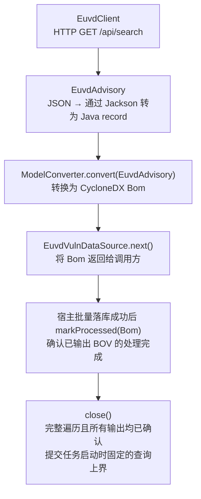

# EUVD 漏洞数据源模块 — 概要设计

## 1. 概述

本文档描述了 Dependency-Track 的 EUVD（欧盟漏洞数据库）数据源模块的设计。该模块通过 ENISA EUVD REST API 将漏洞情报镜像到平台中，遵循既有的 `vuln-data-source` 插件架构。

**基础 API URL：** `https://euvdservices.enisa.europa.eu`
**API 文档：** `https://euvd.enisa.europa.eu/apidoc`

本模块使用的 `/api/search` 端点为 `GET`，无需认证，返回 JSON。


## 2. 目标与定位

### 2.1 主要目标

- 将 EUVD 漏洞元数据镜像为 CycloneDX 漏洞清单（BOV，Bill of Vulnerabilities）
- 将 EUVD 作为与 NVD、GitHub 并列的独立漏洞来源，以 `EUVD + EUVD ID` 保存，通过别名关联其他来源，不合并或覆盖其他来源的漏洞字段
- 交付平台可启用、同步、查询 EUVD 的完整能力，包含自动组件匹配
- 通过基于日期的重叠窗口支持增量同步
- 遵循 JVN/NVD 模块的既有模式
- 通过 `Testable` 接口提供连通性和格式探测
- 遵守项目架构约束（NullAway、JSpecify、Apache 2.0 许可证）

### 2.2 EUVD数据源概述

- 不提供 PURL、CPE 或生态系统信息
- `product_version` 是非结构化的自然语言，不是机器可解析的版本范围
- 部分漏洞的组件信息缺失，不能用于组件漏洞匹配
- 存在 CVE/GHSA 别名时，将 EUVD ID 与对应来源关联；不假设每条记录都有 CVE 别名
- 提供欧洲漏洞评分和漏洞利用预测
- 收集厂商公告和引用
- 由 ENISA 整理的数据，附带欧盟政策背景
- EUVD 参与自动组件匹配：根据厂商和产品构造 CPE，无法解析版本时回退为全版本匹配；接受由此带来的误报风险


## 3. 架构

### 3.1 模块结构

```
vuln-data-source/euvd/
├── pom.xml
└── src/
    ├── main/
    │   ├── java/org/dependencytrack/vulndatasource/euvd/
    │   │   ├── package-info.java              # @NullMarked
    │   │   ├── EuvdVulnDataSourcePlugin.java  # SPI 入口点
    │   │   ├── EuvdVulnDataSourceFactory.java # 工厂 + 配置 + 可测试性
    │   │   ├── EuvdClient.java                # EUVD API 的 HTTP 客户端
    │   │   ├── EuvdAdvisory.java              # 数据模型（Java record）
    │   │   ├── EuvdVulnDataSource.java        # Iterator<Bom> 实现
    │   │   ├── ModelConverter.java             # EUVD → CycloneDX BOV
    │   │   └── WatermarkManager.java          # KV 存储水位线持久化
    │   └── resources/
    │       ├── META-INF/services/org.dependencytrack.plugin.api.Plugin
    │       └── org/dependencytrack/vulndatasource/euvd/
    │           └── euvd-vuln-data-source-config-v1.schema.json
    └── test/
        ├── java/org/dependencytrack/vulndatasource/euvd/
        │   ├── EuvdVulnDataSourceTest.java
        │   ├── EuvdVulnDataSourceFactoryTest.java
        │   └── ModelConverterTest.java
        └── resources/
            ├── simplelogger.properties
            └── euvd-search-response.json      # 测试
```

### 3.2 组件职责

| 组件                          | 职责                                                                                   |
| ----------------------------- | -------------------------------------------------------------------------------------- |
| `EuvdVulnDataSourcePlugin`  | Java SPI 入口点；注册`EuvdVulnDataSourceFactory`                                     |
| `EuvdVulnDataSourceFactory` | 创建`EuvdVulnDataSource` 实例；定义运行时配置；实现连通性/格式探测                   |
| `EuvdClient`                | 封装对 EUVD REST API 的 HTTP 调用；处理分页                                            |
| `EuvdAdvisory`              | 对 EUVD 漏洞 JSON 响应建模的 Java record                                               |
| `EuvdVulnDataSource`        | 实现`VulnDataSource`（`Iterator<Bom>`）；协调获取、转换和水位线推进                |
| `ModelConverter`            | 无状态工具类，将`EuvdAdvisory` 转换为 CycloneDX `Bom` protobuf                     |
| `WatermarkManager`          | 将最后成功同步的固定查询上界（YYYY-MM-DD）持久化到插件 `KeyValueStore` |

### 3.3 数据流



## 4. EUVD API 使用

### 4.1 主要端点：`/api/search`

该模块在 v1 中仅使用分页搜索端点作为数据获取机制。

**请求参数：**

| 参数                | 类型                 | 说明                             |
| ------------------- | -------------------- | -------------------------------- |
| `fromUpdatedDate` | string（YYYY-MM-DD） | 过滤在该日期当天或之后更新的漏洞 |
| `toUpdatedDate`   | string（YYYY-MM-DD） | 过滤在该日期当天或之前更新的漏洞 |
| `page`            | integer（从 0 开始） | 页码                             |
| `size`            | integer（最大 100）  | 每页结果数                       |

**响应格式：**

```json
{
  "items": [
    {
      "id": "EUVD-2026-63374",
      "enisaUuid": "...",
      "description": "...",
      "datePublished": "Mar 6, 2026, 4:45:15 AM",
      "dateUpdated": "Mar 6, 2026, 4:06:23 PM",
      "baseScore": 5.4,
      "baseScoreVersion": "3.1",
      "baseScoreVector": "CVSS:3.1/AV:N/AC:L/PR:L/UI:R/S:C/C:L/I:L/A:N",
      "references": "https://...\nhttps://...\n",
      "aliases": "CVE-2026-29061\nGHSA-q658-hfpg-35qc\n",
      "assigner": "GitHub_M",
      "epss": 0.12,
      "enisaIdProduct": [
        {
          "id": "...",
          "product": { "name": "Gokapi", "vendor": { "name": "Forceu" } },
          "product_version": "< 2.2.3"
        }
      ]
    }
  ],
  "total": 79121
}
```

### 4.2 已知 API 行为

基于线上验证（online verification）：

- `size=101` 会被服务器静默限制为 100
- 请求超出范围的页码返回 HTTP 200 和空 `items`
- 请求不存在的 EUVD ID 返回 HTTP 204 和空响应体
- `fromUpdatedDate` 晚于 `toUpdatedDate` 返回 HTTP 200 和空结果（无参数错误）
- 负数页码被视为第 0 页
- 默认结果似乎按 `dateUpdated` 降序排列，但**该行为未被文档记录，不可依赖**
- 不提供速率限制头、ETag、数据版本或快照标识符

### 4.3 分页策略

1. **初始回填：** 使用按日期窗口的分页（见 6.4 节）
2. **增量同步：** 使用重叠的 `fromUpdatedDate`/`toUpdatedDate` 窗口（见 6.2 节）
3. **页大小限制：** API 每次请求最多返回 100 条记录；我们使用 `size=100`

### 4.4 日期格式说明

EUVD 返回人类可读格式的日期（例如 `"Mar 6, 2026, 4:06:23 PM"`）。该模块使用专用的 `DateTimeFormatter`，模式为 `"MMM d, yyyy, h:m:s a"`，并使用 `Locale.US` 来解析这些日期。

**时区注意事项：** API 未明确说明返回日期的时区。本设计假设按 UTC 解析，但该假设未经验证。为降低时区歧义的风险：

- 将原始日期字符串作为漏洞属性输出，但不落库，仅用于转换链路内的校正排查
- 增量同步从水位线减 1 天开始，以降低日期边界丢失的风险
- 水位线以日期字符串（YYYY-MM-DD）存储，而非亚秒级 epoch 毫秒

## 5. 数据模型

### 5.1 EuvdAdvisory Record

```java
record EuvdAdvisory(String id, JsonNode data) {}
```

`id` 必须是有效的 EUVD ID；`data` 保存原始记录的所有字段。转换器按需读取字段，允许可选字段缺失，并保留未知字段。EPSS 等 JSON 小数使用 BigDecimal 保留精度。

### 5.2 CycloneDX BOV 映射

| EUVD 字段                                           | CycloneDX 字段                                      | 备注                                                         |
| --------------------------------------------------- | --------------------------------------------------- | ------------------------------------------------------------ |
| `id`                                              | `Vulnerability.id`                                | EUVD ID 作为标识符                                           |
| —                                                  | `Vulnerability.source`                            | 硬编码为`"EUVD"`                                           |
| `description`                                     | `Vulnerability.description`                       |                                                              |
| `datePublished`                                   | `Vulnerability.published`                         | 通过 EUVD_DATE_FORMATTER 解析（假设 UTC）                    |
| `dateUpdated`                                     | `Vulnerability.updated`                           | 通过 EUVD_DATE_FORMATTER 解析（假设 UTC）                    |
| `datePublished`（原始）                           | `Property("dependency-track:vuln:datePublished")` | 仅作为属性输出，不落库                                       |
| `dateUpdated`（原始）                             | `Property("dependency-track:vuln:dateUpdated")`   | 仅作为属性输出，不落库                                       |
| `baseScore`                                       | `VulnerabilityRating.score`                       |                                                              |
| `baseScoreVersion`                                | `VulnerabilityRating.method`                      | 映射到`ScoreMethod` 枚举                                   |
| `baseScoreVector`                                 | `VulnerabilityRating.vector`                      |                                                              |
| `aliases`                                         | `VulnerabilityReference`                          | 每个 CVE → source 为 "NVD"，每个 GHSA → source 为 "GITHUB" |
| `references`                                      | `ExternalReference`                               | 每个 URL 一条，去重                                          |
| `assigner`                                        | `Property("dependency-track:vuln:assigner")`      |                                                              |
| `epss`                                            | `Property("dependency-track:vuln:epss")`          | 保留 EUVD 原始值；响应量纲待验证，不直接认定为 0–1 概率 |
| `enisaIdProduct[].product.name` + `vendor.name` | `Component`                                       | CPE：`cpe:2.3:a:{vendor}:{product}:*:*:*:*:*:*:*:*`        |
| `enisaIdProduct[].product_version`                | `VulnerabilityAffects`                            | 将可识别的比较表达式转换为 `vers:generic/…`；失败回退为 `vers:generic/*` |

### 5.3 别名路由

`aliases` 字段包含以换行符分隔的标识符。转换器将：

1. 按换行符分割，去除首尾空白
2. 对于 `CVE-XXXX-XXXXX` 条目：创建 source 为 `NVD` 的 `VulnerabilityReference`
3. 对于 `GHSA-XXXX-XXXXX` 条目：创建 source 为 `GITHUB` 的 `VulnerabilityReference`
4. 跳过空的或无法识别的别名格式

### 5.4 组件构建

EUVD 提供产品名称和厂商名称，但不提供 CPE 或 PURL。将使用构造的 CPE 2.3 标识符创建组件：

```
cpe:2.3:a:{vendor}:{product}:*:*:*:*:*:*:*:*
```

- 使用 `us.springett.parsers.cpe`（已在 pom.xml 中）验证构造的 CPE
- 组件字段：`publisher=vendor`、`name=product`、`cpe=构造的 CPE 字符串`
- bomRef：`UUID.nameUUIDFromBytes(cpe.getBytes(UTF_8))` 以实现确定性标识
- CPE 构造需要处理字段转义；厂商或产品缺失、构造结果无效时不生成匹配坐标，该产品信息被丢弃
- CPE 语法有效不代表与标准产品坐标一致；构造 CPE 的规范化规则需在实现时验证
- `product_version` 字段将尽可能解析为 `vers` 版本范围（见 5.5 节）

### 5.5 product_version 处理

`product_version` 字段是**非结构化的自然语言文本**。已知模式包括：

| 模式           | 示例                                      | 可解析？     |
| -------------- | ----------------------------------------- | ------------ |
| 比较表达式 | `< 2.2.3`                               | 可转换为 `vers:generic/<2.2.3`，原文不是完整的 vers 字符串 |
| 比较表达式     | `10.0.26200.0 <10.0.26200.9168`         | 部分可以     |
| 无数据         | `-`                                     | 不可以       |
| 不适用         | `n/a`                                   | 不可以       |
| URL            | `https://example.com/security-releases` | 不可以       |

解析策略：

1. 识别已支持的精确版本或比较表达式，将范围转换为合法的 `vers:generic/…`；不直接把自然语言传给 vers 解析器
2. 如果解析成功，在 `VulnerabilityAffects` 中输出精确版本或结构化范围
3. 如果解析失败，输出**全版本通配范围** `vers:generic/*` 以保留召回率
4. 如果解析失败，原始 `product_version` 文本不被保留，仅输出 `vers:generic/*`

**已确认的取舍：** 全版本通配表示所有版本受影响，而非“某个版本受影响”。EUVD 是参与自动匹配的独立漏洞源；构造 CPE 和全版本回退可能造成误报，此风险已接受。

## 6. 同步策略

### 6.1 水位线

水位线追踪最后成功同步的日期。

- **存储：** 插件 `KeyValueStore` 中的键 `"watermark"`
- **格式：** `"YYYY-MM-DD"` 日期字符串（例如 `"2026-03-06"`）
- **查询上界：** 在任务启动时获取 UTC 日期 `runEndDate`，本次所有查询使用该固定上界，跨午夜也不改变
- **推进：** 完整成功同步后设置为 `runEndDate`，不取记录中的最大 `dateUpdated` 或任务完成日期；成功的空结果也推进
- **提交：** 仅在完整遍历且所有输出 BOV 均经宿主成功落库后的 `markProcessed` 确认时，由 `close()` 提交
- **失败：** 请求、解析、转换、落库失败或中断均不得提交；`hasNext() == false` 本身不代表成功，尤其不能掩盖最后一批落库失败

使用日期字符串而非 epoch 毫秒，与 API 的天级过滤粒度相匹配，避免虚假精度。

### 6.2 带重叠窗口的增量同步

EUVD API 的日期过滤是天级精度的，且 API 不保证排序顺序。为应对：

- 时区歧义（API 未说明日期的时区）
- 可能被遗漏的临界时间更新
- 当天数据的分页漂移

增量同步使用**重叠时间窗口**：

```
fromUpdatedDate = lastWatermarkDate - 1 天   （重叠）
toUpdatedDate   = runEndDate                  （任务启动时固定的 UTC 日期）
```

这意味着：

- 每次重新获取水位线前一天至本次固定查询上界的记录
- 所有写入都是幂等的 upsert（以来源 EUVD 和 EUVD ID 为键），因此重复处理是安全的
- 重叠窗口降低时区不确定性和临界午夜更新的遗漏风险，但不保证分页绝对无遗漏

### 6.3 不删除策略

EUVD API 不提供：

- 删除列表或墓碑记录
- 变更事件流
- 数据集版本号
- 完整漏洞转储（仅有分页搜索）

因此，该模块遵循**不删除策略**：

- 默认行为仅做 upsert（插入或更新）
- 增量结果中缺失的记录**不会**被删除
- CVE-EUVD 映射 CSV（`/api/dump/cve-euvd-mapping`）可用于定期对账
- `/api/enisaid` 端点（对缺失 ID 返回 HTTP 204）可用于抽查
- 长期陈旧的记录可以标记为人工审查，而不是自动移除

### 6.4 全量回填策略

初始回填不配置历史起始年份，使用以下固定日期窗口：

1. **首个窗口：** 省略 `fromUpdatedDate`，设置 `toUpdatedDate=2000-01-01`，覆盖该日期当天及以前的记录
2. **后续窗口：** 从 `2000-01-02` 开始，首段截止 `2000-01-31`；之后使用完整月度窗口
3. **最终窗口：** 截止任务启动时固定的 `runEndDate`，不使用开放结束日期
4. 对每个窗口以 `size=100` 遍历分页；所有窗口完整处理并落库后才提交水位线
5. v1 不引入按月持久化检查点；回填失败时不提交水位线，下次重新执行初始回填

日期窗口示例（假设 `runEndDate=2026-03-06`，日期边界按包含当天处理）：

```
窗口 1：toUpdatedDate=2000-01-01                       （不设置起点）
窗口 2：fromUpdatedDate=2000-01-02&toUpdatedDate=2000-01-31
窗口 3：fromUpdatedDate=2000-02-01&toUpdatedDate=2000-02-29
...
窗口 N：fromUpdatedDate=2026-03-01&toUpdatedDate=2026-03-06
```

日期筛选是否包含边界当天、是否包含缺失或异常 `dateUpdated` 的记录仍需验证。无起点不等于无日期过滤；若异常日期记录被过滤排除，需要补充无日期过滤的扫描方案（见 16 节）。历史数据量及请求量仅作为容量估算，不作为完整性判定依据。

### 6.5 分页漂移检测

对于当前/最近的日期窗口，记录集合可能在分页过程中发生变化。缓解策略：

1. 记录窗口内的 `total` 变化和重复 ID，作为漂移诊断信息；`total` 不变也不能证明没有遗漏
2. 当前或近期窗口可能漂移，重叠扫描用于降低遗漏风险，不承诺单次扫描绝对无遗漏
3. 所有写入都是幂等的（以来源 EUVD 和 EUVD ID 为键），重复记录可以安全 upsert
4. **不要**依赖默认排序顺序作为增量游标（未文档化的行为）
5. 漂移异常的判定、复扫动作及调度频率尚待确定，不应把诊断信息等同于完整性保证（见 16 节）

### 6.6 可中断性

遵循项目的可中断性指南：

- 数据源实现 `Closeable`
- 水位线仅在完整遍历且全部输出均已确认落库时提交
- 每页获取及重试边界检查中断；不能仅恢复中断标志后继续扫描
- 被中断的运行将从上次提交的水位线重新获取
- EUVD API 是无状态的（无服务端游标），因此被中断的分页可以安全重试
- 失败时，重新执行整个日期窗口，而不仅仅是失败的那一页

## 7. 配置

### 7.1 JSON Schema

```json
{
  "$schema": "https://json-schema.org/draft/2020-12/schema",
  "$id": "https://dependencytrack.org/schemas/euvd-vuln-data-source-config-v1.schema.json",
  "type": "object",
  "javaInterfaces": [
    "org.dependencytrack.plugin.api.config.RuntimeConfig"
  ],
  "properties": {
    "enabled": {
      "type": "boolean",
      "title": "Enabled",
      "description": "Whether the EUVD (EU Vulnerability Database) data source should be enabled."
    },
    "apiUrl": {
      "type": "string",
      "title": "EUVD API base URL",
      "description": "Base URL of the EUVD REST API. Defaults to https://euvdservices.enisa.europa.eu.",
      "format": "uri",
      "minLength": 1
    }
  },
  "required": ["enabled"]
}
```

### 7.2 默认配置

| 属性        | 默认值                                   | 说明              |
| ----------- | ---------------------------------------- | ----------------- |
| `enabled` | `false`                                | 数据源默认禁用    |
| `apiUrl`  | `https://euvdservices.enisa.europa.eu` | EUVD API 基础 URL |

### 7.3 配置校验

- 如果 `enabled` 为 `true`，`apiUrl` 必须是有效的 URI
- 不提供 `startYear` 配置：初始窗口固定为无起点、截止 `2000-01-01`，随后按月回填

## 8. 工厂设计

### 8.1 扩展元数据

| 方法                 | 值                           |
| -------------------- | ---------------------------- |
| `extensionName()`  | `"euvd"`                   |
| `displayName()`    | `"EUVD"`                   |
| `extensionClass()` | `EuvdVulnDataSource.class` |
| `priority()`       | `PRIORITY_HIGHEST + 100`   |

### 8.2 服务依赖

工厂通过 `init(ExtensionContext)` 获取以下宿主服务，遵循当前插件 API：

1. `ConfigRegistry` — 用于运行时配置访问
2. `KeyValueStore` — 用于水位线持久化
3. `HttpClient` — 用于 EUVD API 调用（由宿主应用提供）
4. `OutboundConnectionPolicy` — 沿用宿主的出站连接策略，正式请求和探测均需遵守

### 8.3 创建流程

```
create()
  ├── 从 ConfigRegistry 读取配置
  ├── 构建 WatermarkManager(kvStore)
  ├── 构建 EuvdClient(httpClient, apiUrl)
  └── 返回 EuvdVulnDataSource(client, watermarkManager)
```

### 8.4 测试（探测）流程

```
test(runtimeConfig)
  ├── 检查 enabled 标志
  ├── 按宿主 OutboundConnectionPolicy 校验目标地址
  ├── HTTP GET {apiUrl}/api/search?size=1（探测请求）
  ├── 断言 HTTP 200
  ├── 解析响应 JSON，验证存在 "items" 数组
  └── 返回包含 "connection" 和 "feed_format" 检查的 ExtensionTestResult
```

## 9. HTTP 客户端设计

### 9.1 EuvdClient

```java
final class EuvdClient {
    static final String DEFAULT_API_BASE_URL = "https://euvdservices.enisa.europa.eu";
    static final int MAX_RETRIES = 3;
    static final Duration MAX_RETRY_DELAY = Duration.ofSeconds(60);

    private final HttpClient httpClient;
    private final String apiUrl;
    private final ObjectMapper objectMapper;

    // 返回分页搜索结果
    EuvdSearchResult search(@Nullable String fromUpdatedDate,
                            @Nullable String toUpdatedDate,
                            int page, int size) throws IOException, InterruptedException;
}
```

### 9.2 代理配置

EUVD 使用通过 `ExtensionContext.httpClient()` 获取的宿主提供的 `java.net.http.HttpClient`。宿主的 `HttpClient` 单例（`HttpClient.INSTANCE`）已经通过自定义 `ProxySelector` 内置了代理配置：

- 代理设置从 `dt.http.proxy.*` 配置键或 `https_proxy`/`http_proxy` 环境变量读取
- 支持通过 `dt.http.proxy.exclusions` 或 `no_proxy` 配置不使用代理的列表
- 支持代理基本认证

由于 EUVD 使用与 JVN、NVD 和 OSV 相同的 `java.net.http.HttpClient`，**无需额外的代理配置**。代理自动从宿主继承。

只有 GitHub 模块需要特殊代理处理，因为它使用 Apache HC5（`HttpAsyncClients`）而非 JDK HttpClient。

### 9.3 重试策略

EUVD 使用 `support/net`（`net-support` 构件）中的共享 `HttpRetry` 工具处理瞬时故障。该工具：

- 识别可重试的状态码：**429、502、503、504**
- 解析 `Retry-After` 头（支持秒数和 HTTP-date 两种格式）
- 返回包含 `isRetryable()`、`retryAfter` 和 `description` 的 `HttpRetry` record

`EuvdClient` 用重试循环包装每次 `httpClient.send()` 调用：

```java
private HttpResponse<String> sendWithRetry(HttpRequest request) throws IOException, InterruptedException {
    for (int attempt = 0; attempt <= MAX_RETRIES; attempt++) {
        final HttpResponse<String> response = httpClient.send(request, BodyHandlers.ofString());
        final HttpRetry retry = HttpRetry.of(response);

        if (!retry.isRetryable() || attempt == MAX_RETRIES) {
            return response;
        }

        final Duration delay = retry.retryAfter() != null
                ? retry.retryAfter().minusMillis(1).closerTo(Duration.ZERO, MAX_RETRY_DELAY)
                : Duration.ofSeconds(1L << attempt);  // 指数退避：1s、2s、4s

        LOGGER.warn("{}; retrying in {} (attempt {}/{})", retry.description(), delay, attempt + 1, MAX_RETRIES);
        Thread.sleep(delay);
    }
    throw new AssertionError("unreachable");
}
```

**重试行为：**

| 尝试        | 延迟                    | 备注                                                |
| ----------- | ----------------------- | --------------------------------------------------- |
| 第 1 次重试 | `Retry-After` 头或 1s | 如果服务器提供`Retry-After`，则使用它（上限 60s） |
| 第 2 次重试 | `Retry-After` 头或 2s | 指数退避                                            |
| 第 3 次重试 | `Retry-After` 头或 4s | 最后一次重试                                        |
| 3 次重试后  | —                      | 将失败的响应返回给调用方                            |

**重试耗尽后的错误处理：**

- HTTP 200：解析响应
- HTTP 204：已知行为来自单 ID 查询，尚不能推广到 `/api/search`；验证前作为非预期响应失败，不推进水位线
- 其他非 200 状态码：抛出 IOException，不将错误响应当成空结果
- 重试后仍为 HTTP 429/502/503/504：记录警告，抛出 IOException（调用方将在下次运行时重试该日期窗口）
- 网络错误：传播 IOException（对 `UnknownHostException` 等连通性问题不重试）
- JSON 解析错误：记录警告，抛出 IOException

### 9.4 请求详情

```
GET {apiUrl}/api/search?fromUpdatedDate={date}&toUpdatedDate={date}&page={page}&size=100
Accept: application/json
```

### 9.5 响应模型

```java
record EuvdSearchResult(List<EuvdAdvisory> items, int total) {}
```

## 10. 模型转换器设计

### 10.1 转换算法

```
convert(EuvdAdvisory advisory):
  1. 构建 Vulnerability：
     - source = "EUVD"
     - id = advisory.id()
     - description = advisory.description()
     - published = parseDate(advisory.datePublished())
     - updated = parseDate(advisory.dateUpdated())
     - ratings = [parseRating(advisory)]
     - references = parseAliases(advisory.aliases())
     - properties = [assigner, epss, datePublished, dateUpdated]
     - cwes = []（EUVD 不直接提供 CWE 数据）

  2. 构建 Components + Affects：
     - 遍历每个 enisaIdProduct：
       - 使用 CPE cpe:2.3:a:{vendor}:{product}:*:*:*:*:*:*:*:* 创建 Component
       - 根据 product_version 创建 VulnerabilityAffects 版本范围
       - 如果 product_version 无法解析，使用 vers:generic/* 全版本范围

  3. 构建 External References：
     - 按换行符分割 advisory.references()
     - 去除首尾空白、去重
     - 每个 URL 创建一条 ExternalReference

  4. 组装 Bom：
     - 添加所有 components
     - 添加带 affects 的 vulnerability
     - 添加 external references
```

### 10.2 日期解析

EUVD 返回的日期格式为：`"Mar 6, 2026, 4:06:23 PM"`

专用的日期解析器将使用 `java.time.format.DateTimeFormatter` 处理此格式：

```java
private static final DateTimeFormatter EUVD_DATE_FORMATTER =
    DateTimeFormatter.ofPattern("MMM d, yyyy, h:m:s a", Locale.US)
        .withZone(ZoneId.of("UTC"));
```

**注意：** UTC 是尚未验证的实现假设，不能从机构所在地区推断。原始日期字符串仅作为 BOV 属性输出、不落库，无法支持后续离线校正；查询上界日期与响应日期的时区语义需分别验证。

### 10.3 CVSS 版本映射

| `baseScoreVersion` | `ScoreMethod`          |
| -------------------- | ------------------------ |
| `"2"`              | `SCORE_METHOD_CVSSV2`  |
| `"3"`              | `SCORE_METHOD_CVSSV3`  |
| `"3.1"`            | `SCORE_METHOD_CVSSV31` |
| `"4"` 或 `"4.0"` | `SCORE_METHOD_CVSSV4`  |
| 其他                 | `SCORE_METHOD_OTHER`   |

### 10.4 EPSS 标度

API 文档中的 EPSS 筛选参数范围为 0–100，而响应示例包含 `0.12`；这不能证明响应值是 0–1 概率还是百分比。

- EUVD 原始 EPSS 值仅作为 `Property("dependency-track:vuln:epss")` 输出，不落库
- 响应量纲验证后，再明确标准化为 0–1 概率的映射；验证前不猜测换算
- 宿主现有 EPSS 展示来自按 CVE 查询的独立服务，不能直接把 EUVD 属性视为该服务的数据；EUVD EPSS 不覆盖该服务

## 11. 水位线管理器设计

### 11.1 存储

| 键              | 值                                        | 说明               |
| --------------- | ----------------------------------------- | ------------------ |
| `"watermark"` | `"YYYY-MM-DD"`（例如 `"2026-03-06"`） | 最后成功同步的日期 |

### 11.2 操作

- **`getWatermark()`**：从 KV 存储读取已提交的水位线（构造时执行）
- **`commit(LocalDate)`**：仅在本次遍历完成且全部输出均已确认处理后，通过 `compareAndPut` 持久化固定 `runEndDate`（乐观并发）；成功空结果同样适用，失败或中断路径不调用
- 数据源需跟踪遍历状态和已输出但未确认的 BOV，重复 ID 也不能导致确认计数失真；遍历完成后仍有未确认输出时不得提交

### 11.3 并发

使用 `KeyValueStore.compareAndPut()` 配合版本跟踪实现乐观并发，与 JVN/NVD WatermarkManager 实现中的模式一致。

## 12. 依赖

### 12.1 现有依赖（已在 pom.xml 中）

| 依赖                        | 作用域   | 用途                  |
| --------------------------- | -------- | --------------------- |
| `vuln-data-source-api`    | provided | 插件 SPI 契约         |
| `plugin-testing`          | test     | 测试工具              |
| `jackson-databind`        | compile  | JSON 反序列化         |
| `jackson-datatype-jsr310` | compile  | Java 8+ 日期时间支持  |
| `versatile-core`          | compile  | `vers` 版本范围解析 |
| `jspecify`                | compile  | 可空性注解            |
| `cpe-parser`              | compile  | 构造 CPE 的 CPE 验证  |
| `junit-jupiter`           | test     | 测试框架              |
| `json-unit-assertj`       | test     | JSON 断言工具         |
| `wiremock-standalone`     | test     | HTTP stub             |
| `slf4j-api`               | provided | 日志                  |
| `slf4j-simple`            | test     | 测试日志              |

### 12.2 需要新增的依赖

| 依赖                   | 作用域  | 用途                                  |
| ---------------------- | ------- | ------------------------------------- |
| `net-support`        | compile | `HttpRetry` 工具，用于瞬时故障处理  |
| `protobuf-java-util` | compile | CycloneDX protobuf 工具（Timestamps） |

### 12.3 构建插件

将添加 `jsonschema2pojo-maven-plugin`，从配置 schema 生成 `EuvdVulnDataSourceConfigV1.java`，遵循与 JVN/NVD 模块相同的模式。

## 13. 已确定的设计决策

| 决策                | 结论                                                                                                      |
| ------------------- | --------------------------------------------------------------------------------------------------------- |
| 无 CPE 时的组件标识 | 使用构造的 CPE 2.3：`cpe:2.3:a:{vendor}:{product}:*:*:*:*:*:*:*:*`                                      |
| 日期格式可靠性      | 使用`DateTimeFormatter.ofPattern("MMM d, yyyy, h:m:s a", Locale.US)` 并假设 UTC；原始字符串仅作为属性输出，不落库 |
| EPSS 存储           | 输出原始值为 `Property("dependency-track:vuln:epss")`，不落库；响应量纲待验证                                   |
| 增量同步参数        | 使用`fromUpdatedDate` 配合重叠窗口（水位线 - 1 天）                                                     |
| 水位线格式          | 日期字符串`YYYY-MM-DD`，与 API 的天级过滤粒度匹配                                                       |
| 删除处理            | 仅 upsert，不软删除；缺失的记录不被移除                                                                   |
| product_version     | 转换可识别表达式为合法 vers，失败回退为 `vers:generic/*`，表示所有版本受影响；原始文本不保留                                                               |
| 重试策略            | 使用`net-support` 中的 `HttpRetry`，最多 3 次重试、指数退避、支持 `Retry-After` 头                  |
| 代理配置            | 通过 `ExtensionContext` 从宿主 `HttpClient` 继承，无需额外代理配置                                        |
| 来源定位 | 独立保存 EUVD 漏洞，不覆盖 NVD/GitHub；通过 CVE/GHSA 别名关联 |
| 匹配策略 | EUVD 参与自动匹配，接受构造 CPE 和全版本回退的误报风险 |
| 平台交付 | 可启用、同步、查询 EUVD |
| 初始窗口 | 不设置起点，终点为 `2000-01-01`；后续从 `2000-01-02` 按月扫描 |
| 水位线语义 | 最后成功同步的固定 UTC 查询上界；全部输出确认落库后提交，成功空结果也推进 |

## 14. 未来增强（v1 范围之外）

- **CVE-EUVD 映射 CSV 同步**（`/api/dump/cve-euvd-mapping`）：可富化别名数据并支持定期对账
- **KEV 转储同步**（`/api/kev/dump`）：可富化已知被利用漏洞（Known Exploited Vulnerability）状态
- **完整 ID 对账**：通过 CVE-EUVD 映射定期扫描所有 EUVD ID 以检测陈旧记录

## 15. 实现顺序

1. `package-info.java` + 更新 `EuvdVulnDataSourcePlugin.java`
2. 配置 schema JSON + pom.xml 中的构建插件
3. `EuvdAdvisory.java`（数据模型）
4. `EuvdClient.java`（HTTP 客户端）
5. `ModelConverter.java`（EUVD → CycloneDX）
6. `WatermarkManager.java`（KV 存储持久化）
7. `EuvdVulnDataSource.java`（迭代器编排）
8. `EuvdVulnDataSourceFactory.java`（工厂 + 配置 + 可测试性）
9. 宿主集成：新增 EUVD 来源识别、别名转换及查询返回，接入镜像工作流和现有 CPE 匹配链路
10. 将模块接入 `apiserver/pom.xml` 和 `coverage-report/pom.xml`；子模块加入父模块不足以使平台加载插件
11. 测试夹具、模块测试及宿主集成测试；涉及存储或接口的显著架构变更按仓库要求编写 ADR
12. 执行 `make format-java AGENT=1`、`make build AGENT=1`；模块测试使用 `make test-single MODULE=vuln-data-source/euvd TEST="*Test" AGENT=1`，宿主测试使用对应的 apiserver 测试类
13. 若修改 OpenAPI 或迁移，分别执行 `make lint-openapi AGENT=1`、`make lint-migrations AGENT=1`

## 16. 实现前技术验证与待细化项

已确认的业务决策以第 13 节为准。以下内容尚未确认，不能以推测当成上游契约或已完成的设计：

- **EPSS：** 验证响应量纲及异常值，确定标准化映射；不依据单条样例或筛选参数直接判断
- **日期过滤：** 验证日期边界是否包含当天、响应时区，以及缺失/异常 `dateUpdated` 是否被日期过滤排除；若被排除，需设计无日期过滤补扫
- **HTTP 204：** 验证搜索端点是否可能返回 204；单 ID 查询的验证结果不能直接套用
- **原始字段落库：** 不落库。原始 JSON 不随 BOV 传递，也不写入独立数据表；未映射到持久化模型的字段（EPSS、assigner、原始日期、无法构造 CPE 的产品）在转换时丢弃。标准化 EPSS 的后续映射仍依赖量纲验证
- **解析规则：** 明确支持的版本表达式、CPE 字段规范化/转义、可空字段和未知 JSON 字段处理；坏数据的字段省略与整次失败边界需明确，不能静默跳过后提交成功水位线
- **分页漂移：** 明确分页终止条件、异常判定及复扫动作；增量调度默认每小时执行（见 18 节），复扫与定期校验安排尚未确定

## 17. 测试与验收

- **平台集成：** EUVD 可发现、默认禁用、启用后可触发同步并查询；来源为 EUVD，不回落为 UNKNOWN，不覆盖 NVD/GitHub 数据
- **别名：** CVE/GHSA 拆分、去重和持久化；无别名的 EUVD 记录也可独立保存
- **匹配：** 可解析版本生成结构化范围；不可解析、空值、`-`、`n/a` 和 URL 回退为 `vers:generic/*`；匹配结果可关联到 EUVD 漏洞
- **原始信息：** 不提供原始信息查询。EPSS、assigner、原始日期仅作为 BOV 属性输出，不落库；无法构造 CPE 的产品信息被丢弃
- **回填边界：** 首窗不发送起点、终点为 `2000-01-01`；次窗从 `2000-01-02` 开始，覆盖月末、闰年和最终固定上界
- **水位线：** 成功空结果推进；跨午夜不改变查询上界；全部输出确认后才提交；遍历结束但最后一批落库失败、提前关闭、请求/解析失败及中断均不提交
- **分页和重试：** 空页、重复 ID、数量变化、429/502/503/504、Retry-After 及重试耗尽；失败不被当作成功空结果
- **并发与取消：** 水位线 compareAndPut 冲突可见，确认计数对重复 ID 正确；分页获取和退避等待可以中断

## 18. v1 实现补充

- 上游记录以 `EuvdAdvisory(id, data)` 建模，`data` 保留完整 JSON，包含未知字段；新增字段无需先修改 record 即可被转换器读取。未映射到持久化模型的字段在转换时丢弃，不落库。
- BOV 不携带原始 JSON；`dependency-track:euvd:raw` 属性已移除，宿主无原始数据表可写。
- 无原始数据查询接口；`GET /api/v2/vulns/{source}/{vuln_id}/source-data` 未实现。
- EPSS 以原始数值作为 `Property("dependency-track:vuln:epss")` 输出，不进行未验证的量纲换算，不覆盖独立 CVE EPSS 服务。
- 默认每小时重扫重叠窗口，调度配置键为 `dt.task.euvd-vuln-data-source-mirror.cron`；插件仍默认禁用。
- 版本解析支持精确版本和由 `<`、`<=`、`>`、`>=`、`=` 组成、以空白分隔的比较表达式；其他文本回退为 `vers:generic/*`。CPE 字段使用小写、空白转下划线并转义其他特殊字符。
- 分页以空页结束窗口，记录 total 变化和重复 ID，不以 total 作为稳定快照或排序保证。
- 迭代器遇到中断时标记本次失败、恢复中断标志并停止获取；宿主在遍历结束后检查中断并抛出 `InterruptedException`，避免将取消当成成功。
- 第 16 节的响应时区、EPSS 量纲和异常日期覆盖仍需上游验证；现有实现不承诺无遗漏快照或全量对账。
